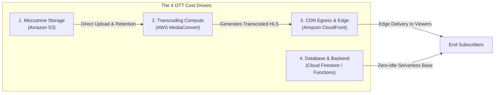

# Unified OTT Platform — Nonfunctional Requirements & Cost Architecture

- **Document Version:** 1.0.0
- **Document Status:** PROPOSED BASELINE SPECIFICATION (Phase 2 Deliverable)
- **Author:** Principal Systems Architect, Cloud Infrastructure Architect

---

## 1. Nonfunctional Requirements (NFR) Framework

The platform adheres to measurable, realistic nonfunctional engineering targets. Requirements are categorized into:
- **[PROD-REQ]:** Core business and functional requirements.
- **[TECH-CONST]:** Non-negotiable technical constraints dictated by platform choices.
- **[PROP-TGT]:** Proposed initial performance and reliability service-level targets.
- **[DEC-REQ]:** Parameters requiring formal operator or product approval.

---

### 1.1 Performance & Playback Experience

| Requirement ID | Metric / Target | Category | Specification & Measurement Method |
|---|---|---|---|
| **NFR-PERF-01** | Time-to-First-Frame (TTFF) | **[PROP-TGT]** | Main video playback must render the first decoded video frame in **< 1.8 seconds** on 4G LTE/Wi-Fi (measured from user tap to ExoPlayer `STATE_READY`). |
| **NFR-PERF-02** | Hero Trailer Playback Latency | **[PROP-TGT]** | Hero trailer autoplay must initiate in **< 1.2 seconds** after the user lands on the Home Screen. |
| **NFR-PERF-03** | Playback Authorization Latency | **[PROP-TGT]** | Function `authorizePlayback` must return signed cookies in **< 350ms** (p95) under warm conditions; **< 900ms** under cold start. |
| **NFR-PERF-04** | Catalog Navigation Latency | **[PROP-TGT]** | Firestore cached query rendering in Android Compose and Web client must complete in **< 150ms** (p90). |
| **NFR-PERF-05** | Re-buffering Ratio | **[PROP-TGT]** | Total re-buffering time must not exceed **< 0.5%** of total stream duration on standard broadband connections. |

---

### 1.2 Availability, Scalability & Reliability

| Requirement ID | Metric / Target | Category | Specification & Measurement Method |
|---|---|---|---|
| **NFR-REL-01** | Video Delivery Availability | **[PROP-TGT]** | CloudFront CDN edge availability target: **99.99%** uptime. |
| **NFR-REL-02** | Backend API Availability | **[PROP-TGT]** | Firebase Cloud Functions + Firestore availability target: **99.95%** uptime. |
| **NFR-REL-03** | Horizontal Concurrency | **[PROP-TGT]** | System must support a minimum baseline of **1,000 concurrent streaming sessions** without infrastructure reconfiguration or manual intervention. |
| **NFR-REL-04** | S3 Data Durability | **[TECH-CONST]** | Amazon S3 Standard provides **99.999999999% (11 9's)** annual durability for transcoded and master media assets. |
| **NFR-REL-05** | Disaster Recovery RTO & RPO | **[PROP-TGT]** | Recovery Time Objective (RTO) **< 2 hours**; Recovery Point Objective (RPO) **< 15 minutes** (enabled by S3 versioning and automated Firestore daily backups). |

---

### 1.3 Maintainability, Observability & Security

| Requirement ID | Metric / Target | Category | Specification & Measurement Method |
|---|---|---|---|
| **NFR-SEC-01** | Cookie Expiration Window | **[TECH-CONST]** | CloudFront signed cookies expire in **15 minutes** (`playback.ts:193`). Client players must renew authorization for long viewing sessions exceeding expiration. |
| **NFR-SEC-02** | Zero Client Secrets | **[TECH-CONST]** | Zero cloud secrets, private keys, or payment private keys may be bundled in the Android APK or web JavaScript distributions. |
| **NFR-OBS-01** | Centralized Logging & Telemetry | **[PROD-REQ]** | All API errors, failed authorization attempts, transcode failures, and payment anomalies must be logged with structured JSON to Google Cloud Logging and AWS CloudWatch. |
| **NFR-A11Y-01** | Web Accessibility Compliance | **[PROD-REQ]** | Consumer website must adhere to **WCAG 2.1 Level AA** standards, including screen-reader labels, high contrast ratios, and keyboard navigation. |

---

## 2. Video Streaming Cost Architecture & Economic Drivers

Streaming video costs represent the overwhelming majority of an OTT platform's operating budget. Rather than fabricating false-precision dollar figures, this section breaks down the physical cost drivers, pricing equations, and architectural optimizations needed to operate a sustainable, cost-effective platform.

### 2.1 The Four Primary Cost Pillars



---

### 2.2 Cost Driver Breakdown & Equations

#### 1. Source & Master Video Storage (Amazon S3)
- **Cost Mechanism:** Priced per GB/month stored in S3 Standard (~$0.023/GB in `us-east-1`).
- **Raw Driver:** Uncompressed mezzanine source uploads (e.g. 5GB–10GB per movie master).
- **Architectural Optimization:**
  - `staging/main.tf:54-74` defines an S3 lifecycle policy:
    ```hcl
    rule {
      id = "expire_uploads"
      filter { prefix = "uploads/" }
      expiration { days = 30 }
    }
    ```
  - Source mezzanine uploads are automatically deleted 30 days after transcoding is completed. Only lightweight HLS output assets in `content/` are retained permanently.

#### 2. Transcoding Compute (AWS Elemental MediaConvert)
- **Cost Mechanism:** Priced per minute of transcoded video output (~$0.0075–$0.015 per minute of HD video).
- **Raw Driver:** Total duration of ingested catalog titles multiplied by the number of output renditions in the ABR ladder.
- **Architectural Optimization:**
  - Uses QVBR (Quality-Defined Variable Bitrate) rate-control mode (`media.ts:196-198`). QVBR automatically reduces bitrates during static scenes while preserving quality during high-action sequences, reducing both encoding complexity and output file size by **30–45%** compared to traditional CBR.

#### 3. Content Delivery Network Egress (Amazon CloudFront)
- **Cost Mechanism:** CloudFront charges for Data Transfer Out (DTO) to the internet (~$0.085/GB in US/EU; ~$0.109/GB in India; tiered volume discounts).
- **Raw Driver:** 
  $$\text{Total Monthly DTO (GB)} = \text{Active Subscribers} \times \frac{\text{Viewing Hours}}{\text{Month}} \times \text{Average Bitrate (GB/hr)}$$
- **Bitrate Reference Table:**
  - 1080p Full HD (5.0 Mbps) = ~2.25 GB / hour
  - 720p HD (2.5 Mbps) = ~1.125 GB / hour
  - 480p SD (1.0 Mbps) = ~0.45 GB / hour
  - 360p Mobile (0.6 Mbps) = ~0.27 GB / hour
- **Architectural Optimization (Cache Hit Ratio):**
  - Static media segments (`.ts` and `.m4s`) are immutable. `staging/main.tf:220-222` sets `min_ttl = 86400`, `default_ttl = 86400`, and `max_ttl = 31536000` (1 year).
  - High cache hit ratios (**> 95%**) ensure that repeated segment requests are served entirely from CloudFront edge memory, completely eliminating S3 egress fees for popular content.

#### 4. Backend Operations (Cloud Functions & Firestore)
- **Cost Mechanism:** Firestore document reads ($0.06 / 100K reads) and Cloud Functions invocations ($0.40 / million calls + compute duration).
- **Raw Driver:** User API interactions and rate-limited playback authorization calls.
- **Cost Profile:** Negligible compared to video delivery (typically **< 2%** of overall platform infrastructure bill). At idle, baseline cost is **$0.00/month**.

---

## 3. Modeling Scenarios & Missing Inputs for Precision Planning

To establish an exact operating budget, the following parameters are currently marked **[DEC-REQ]** and require operator confirmation:

| Unknown Input | Required Operator Input | Architectural Impact | Initial Working Assumption |
|---|---|---|---|
| **Catalog Volume** | Total hours of initial video catalog to ingest | Determines upfront MediaConvert encoding budget | 100 hours of HD video (~$90 encoding cost) |
| **Active Subscribers** | Projected paying subscribers in Month 1–3 | Scales CloudFront bandwidth and Firestore reads | 1,000 active subscribers |
| **Average Consumption** | Estimated streaming hours per subscriber per month | Directly scales CloudFront data transfer out | 20 hours / month / subscriber |
| **Regional Distribution** | % of viewers in India vs US vs Europe | CloudFront bandwidth pricing varies by region | 70% India (ap-south-1), 30% US/EU |
| **Max Bitrate Ceiling** | Whether to offer 4K UHD or cap at 1080p | 4K streams increase bandwidth by 300% | Cap initial streaming at 1080p (5 Mbps) |

### 3.1 Initial Sizing Estimate (1,000 Subscribers, 20 hrs/mo, 720p/1080p Blended at 1.5 GB/hr)
- **Total Stream Volume:** $1,000 \times 20 \times 1.5\text{ GB} = 30,000\text{ GB (30 TB/month)}$.
- **CloudFront DTO Cost:** $30,000\text{ GB} \times \$0.095/\text{GB} \approx \$2,850/\text{month}$.
- **Storage Cost (HLS Assets):** 100 hours $\times 3\text{ GB/hr} = 300\text{ GB} \times \$0.023 \approx \$6.90/\text{month}$.
- **Backend & Database:** Free tier or minimal usage $\approx \$10.00/\text{month}$.
- **Total Infrastructure Baseline:** $\approx \$2,870/\text{month}$ (or **~$2.87 per active subscriber per month**).

> [!TIP]
> **Key Business Insight:** Bandwidth is the dominant cost driver. Setting default video quality to 720p on mobile devices drops the per-subscriber delivery cost from ~$2.87 down to **~$1.40/month**, directly protecting gross subscription margins.
