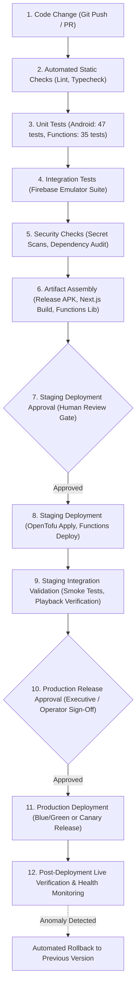

# Unified OTT Platform — Environment & Deployment Strategy

- **Document Version:** 1.0.0
- **Document Status:** PROPOSED OPERATIONAL STRATEGY (Phase 2 Deliverable)
- **Author:** Cloud Infrastructure Architect, Release Engineering Lead
- **Target Environments:** Local Development, CI/CD Automated Testing, Staging, Production

---

## 1. Multi-Environment Topology & Isolation Boundaries

To guarantee security, eliminate data corruption risks, and prevent test operations from affecting live billing, the platform defines four strictly isolated operational tiers. Under no circumstances may staging and production share databases, encryption keys, S3 buckets, or payment credentials.

### 1.1 Environment Boundary Matrix

| Resource / Subsystem | Tier 1: Local Development | Tier 2: Automated CI/CD | Tier 3: Staging Environment | Tier 4: Production Environment |
|---|---|---|---|---|
| **Purpose** | Offline feature dev & unit tests | Headless PR validation & linting | Integration, transcode & QA validation | Live subscriber traffic & real revenue |
| **Firebase Project** | Local Firebase Emulator Suite | Emulator in GitHub Actions | `ott-staging-cloud` | `ott-production-cloud` |
| **Auth Domain** | `localhost:9099` | Mock Auth / Emulator | `ott-staging.firebaseapp.com` | `auth.streamingplatform.com` |
| **Database** | Firestore Emulator (`:8080`) | In-memory Emulator | Dedicated Staging Firestore Instance | Dedicated Production Firestore Instance |
| **Backend Functions** | Functions Emulator (`:5001`) | Mocked Unit Tests (`npm test`) | Staging Cloud Functions | Production Cloud Functions |
| **AWS Account / IAM** | Local AWS Mock / Unconfigured | Mocked AWS SDK in tests | AWS Account `staging` (or isolated VPC/tags) | AWS Account `production` |
| **S3 Content Bucket** | `s3://local-mock` / Unused | In-memory / Mocked | `s3://ott-staging-content-bucket` | `s3://ott-prod-content-bucket` |
| **S3 `force_destroy`** | Allowed | N/A | Allowed (Guarded by Precondition) | **STRICTLY PROHIBITED (Fail-Closed)** |
| **CloudFront CDN** | Unused / Direct Local | Unused | `d-staging.cloudfront.net` | `cdn.streamingplatform.com` (Custom SSL) |
| **Signing Key Pair** | Mock RSA Key | Mock RSA Key | Staging Key Pair (`CLOUDFRONT_KEY_STAGING`) | Production Key Pair (Rotated annually) |
| **Payment Gateway** | Sandbox Mock | Mocked Webhook Tests | Gateway Test Mode (`sk_test_*`) | Gateway Live Mode (`sk_live_*`) |
| **Webhook Secrets** | `local-test-secret` | Mock Secret in Jest | Staging Secret (Firebase Secret Mgr) | Production Secret (Firebase Secret Mgr) |
| **Android APK** | Debug (`debugImplementation`) | Headless Lint & Unit Tests | Staging APK (`BuildConfig.IS_STAGING`) | Release APK (ProGuard/R8, Keystore Signed) |
| **Website Hosting** | `localhost:3000` | Static Build Check (`next build`) | Firebase Hosting / Vercel Staging | Custom Domain Edge Hosting |

---

## 2. CI/CD Lifecycle & Continuous Delivery Pipeline

The deployment architecture employs an automated 12-stage promotion lifecycle. Every stage has an explicit pass/fail gate.

### 2.1 Detailed Stage Descriptions

1. **Stage 1 — Code Change:** Commit pushed to a feature branch; Pull Request opened against `main`.
2. **Stage 2 — Static Checks:**
   - Android: `./gradlew lintDebug` (Exit code 0 required).
   - Functions: `npm run build` (`tsc` compilation with 0 diagnostic errors).
   - Website: `npm run lint` / ESLint validation.
   - OpenTofu: `tofu fmt -check` (Standard HCL formatting).
3. **Stage 3 — Unit Tests:**
   - Android: `./gradlew testDebugUnitTest` (All 47 unit tests must pass).
   - Backend: `npm run test:unit` (All 35 unit tests must pass).
4. **Stage 4 — Local Integration Tests:**
   - Firebase Emulator Suite spin-up (`npm run test:integration`). Tests Firestore security rules and multi-step transactions in a local virtualized environment.
5. **Stage 5 — Security Checks:**
   - Dependency audit: `npm audit` and Gradle dependency check.
   - Secret scan: Git pre-commit and CI scans ensure no `.pem`, `.key`, `google-services.json`, or API keys are committed.
6. **Stage 6 — Build Artifacts:**
   - Compile Android APKs (`assembleDebug`, `assembleRelease`).
   - Bundle frontend assets (`next build` / Vite build).
   - Compile TypeScript functions into `lib/`.
7. **Stage 7 — Staging Deployment Approval Gate:**
   - Automated checks must pass 100%. Requires code review approval on GitHub PR.
8. **Stage 8 — Staging Deployment:**
   - Run OpenTofu plan/apply for AWS staging resources: `tofu apply "tfplan"`.
   - Deploy Cloud Functions and Firestore rules to staging Firebase project: `firebase deploy --only functions,firestore`.
9. **Stage 9 — Staging Validation:**
   - Verify S3 upload pre-signing and MediaConvert transcode job execution.
   - Validate CloudFront signed cookie playback on Android test device and browser.
   - Issue test webhook payload and verify subscription activation.
10. **Stage 10 — Production Release Approval Gate:**
    - Explicit sign-off required from Lead Architect and Release Engineer.
11. **Stage 11 — Production Deployment:**
    - Execute production OpenTofu pipeline.
    - Deploy production Cloud Functions with mounted production secrets.
    - Deploy production Web assets.
    - Release signed Android App Bundle (AAB) to Google Play Console Internal Track.
12. **Stage 12 — Post-Deployment Verification & Rollback:**
    - Run automated health probes against production endpoints.
    - Monitor CloudWatch and Firebase error logging for 60 minutes.
    - If error rate exceeds 0.5%, execute immediate rollback using `ROLLBACK_PLAN.md`.

---

## 3. Local vs. Staging Validation Matrix

The platform clearly distinguishes between validations that execute locally without external dependencies and those requiring deployed staging infrastructure.

| Validation Task | Execution Location | External Prerequisites | Current Status |
|---|---|---|---|
| **Android Compilation & Unit Tests** | Local Workstation / CI | Adoptium JDK 17, Android SDK 34 | **VERIFIED (PASS)** |
| **Functions Compilation (`tsc`)** | Local Workstation / CI | Node.js 18, npm | **VERIFIED (PASS)** |
| **Functions Unit Tests (Jest)** | Local Workstation / CI | Node.js 18, npm | **VERIFIED (PASS)** |
| **OpenTofu Syntax & Provider Validation** | Local Workstation / CI | OpenTofu v1.12.6 | **VERIFIED (PASS)** |
| **Functions Integration Tests** | Local Workstation | Firebase Emulator Suite running | **BLOCKED (BLK-04)** |
| **Android Instrumentation Tests** | Local Workstation / Lab | Running Android Emulator / Physical Device | **BLOCKED (BLK-03)** |
| **OpenTofu Live Plan Generation** | Staging Cloud | AWS Staging IAM Credentials | **BLOCKED (BLK-05)** |
| **S3 Upload & MediaConvert Transcoding** | Staging Cloud | Provisioned S3 & MediaConvert endpoint | **BLOCKED (Needs Staging)** |
| **CloudFront Signed Cookie Playback** | Staging Cloud | Provisioned CloudFront Distribution & Key Pair | **BLOCKED (Needs Staging)** |
| **Live Payment Gateway Checkout** | Staging Cloud | Gateway Sandbox API Keys | **BLOCKED (Needs Staging)** |

---

## 4. Formal Reservation of Live Validation for Phase 9

> [!IMPORTANT]
> **Architectural Invariant:**
> Phases 2 through 8 prepare, implement, and validate components locally and in staging preparation without confusing local test passes with live-system verification.
> 
> **Phase 9 is explicitly reserved as the deployment and live-application acceptance phase.**
> Under no circumstances will the platform be certified for production release prior to the successful execution of all Phase 9 live validation gates, including:
> 1. Full live deployment of S3, MediaConvert, CloudFront, and Firebase Functions.
> 2. Live media ingestion of real 4K/HD video masters and verified ABR HLS delivery.
> 3. Real-device Android streaming playback under adverse network conditions.
> 4. End-to-end sandbox payment completion and subscription entitlement activation.
> 5. Live penetration testing, rate-limit stress testing, and cost telemetry observation.
