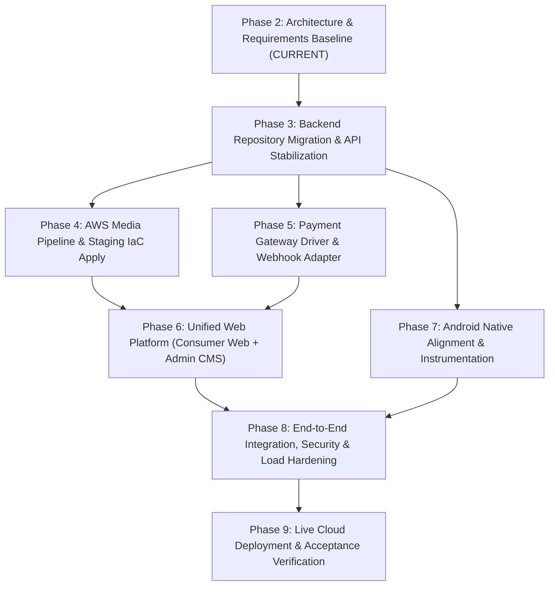

# Unified OTT Platform — Phased Implementation Roadmap

- **Document Version:** 1.0.0
- **Document Status:** PROPOSED ROADMAP (Phase 2 Deliverable)
- **Author:** Principal Software Architect, OTT Platform Technical Lead
- **Execution Model:** Dependency-Aware Phased Delivery with Explicit Exit Gates.
- **Critical Policy:** No application scaffolding or cloud infrastructure deployment occurs in Phase 2. Phase 9 is strictly reserved for live deployment and end-to-end live application acceptance.

---

## 1. Roadmap Overview & Dependency Graph

The platform implementation is structured into 8 subsequent sequential and parallel phases following the completion of Phase 2.

---

## 2. Phase-by-Phase Execution Specifications

### Phase 2: Architecture & Requirements Baseline (Current Phase)
- **Objective:** Establish the authoritative architectural blueprint, logical API contracts, data ownership rules, threat models, cost drivers, and implementation roadmap.
- **Prerequisites:** Phase 1 Stabilization Report and reproducible unit test verification.
- **Components Affected:** Documentation under `docs/architecture/` and ADRs.
- **Required Changes:** System inspection, contract authoring, matrix synthesis. **Zero application implementation or infrastructure modifications permitted.**
- **Deliverables:**
  - 8 Architecture Decision Records (`ADR-001` through `ADR-008`).
  - 9 Architecture Specifications (`SYSTEM_ARCHITECTURE.md`, `CAPABILITY_AND_REQUIREMENTS_MATRIX.md`, `API_CONTRACT.md`, `DATA_MODEL_AND_OWNERSHIP.md`, `SECURITY_ARCHITECTURE.md`, `ENVIRONMENT_AND_DEPLOYMENT_STRATEGY.md`, `COST_AND_NONFUNCTIONAL_REQUIREMENTS.md`, `IMPLEMENTATION_ROADMAP.md`, `PHASE_2_ARCHITECTURE_REPORT.md`).
  - Machine-readable `requirements_inventory.json`.
- **Exit Gate:** Architectural sign-off by product owner; approval of ADR-001 through ADR-008.

---

### Phase 3: Backend Repository Migration & API Stabilization
- **Objective:** Migrate Cloud Functions, Firestore security rules, and backend configuration from `Android - OTT/functions` into the dedicated `ott-backend` repository (`Backend/`). Establish backend CI/CD, resolve non-breaking dependencies, and formalize Series/Season/Episode schemas.
- **Prerequisites:** Phase 2 Architecture Approval; Operator approval of ADR-003.
- **Components Affected:** `Backend/` (`ott-backend.git`), `Android - OTT/` (`ott-android.git`).
- **Required Changes:**
  - Copy `functions/`, `firestore.rules`, `firebase.json` to `Backend/`.
  - Add `firestore.indexes.json` with composite indexes for catalog and subscriptions.
  - Establish Series/Season/Episode data models and add unit test coverage.
  - Setup GitHub Actions workflow in `ott-backend` running `npm run build` and `npm run test:unit`.
  - Resolve harmless devDependency vulnerabilities in `package.json` where non-breaking.
- **Test Strategy:** Run `npm run test:unit` in `Backend/` (must pass 35+ tests); run Firebase Emulator Suite to verify rules.
- **Exit Gate:** `ott-backend` passes 100% of unit tests and TypeScript compilation; backend cleanly decoupled from Android repository.

---

### Phase 4: AWS Media Pipeline & Staging Infrastructure Integration
- **Objective:** Provision AWS staging resources using OpenTofu (`staging/main.tf`), configure CloudFront Key Pairs in Firebase Secret Manager, and verify end-to-end HLS media transcoding via AWS MediaConvert.
- **Prerequisites:** Operator supplies valid AWS staging IAM credentials (BLK-05); Phase 3 backend stabilization.
- **Components Affected:** `staging/` (OpenTofu), Firebase Secrets, AWS S3, CloudFront, MediaConvert.
- **Required Changes:**
  - Generate RSA-2048 CloudFront key pair; upload public key via OpenTofu.
  - Run `tofu plan -out=tfplan` and `tofu apply "tfplan"` in `staging/`.
  - Provision Firebase Secrets: `CLOUDFRONT_PRIVATE_KEY`, `CLOUDFRONT_KEY_PAIR_ID`, `MEDIACONVERT_SNS_TOPIC_ARN`.
  - Ingest test video file via `createMediaUpload` -> S3 -> MediaConvert -> `mediaConvertWebhook`.
- **Test Strategy:** Verify HLS playlist generation (`.m3u8`) and `.ts` chunk output in S3 bucket; verify CloudFront signed cookie access.
- **Exit Gate:** MediaConvert successfully outputs multi-rendition HLS; CloudFront serves signed video stream; zero S3 public access.

---

### Phase 5: Payment Gateway Driver & Webhook Reconciliation
- **Objective:** Implement provider-specific payment gateway driver (Stripe or Razorpay), mount webhook signing secrets, and verify end-to-end subscription lifecycle in sandbox.
- **Prerequisites:** Operator confirms payment gateway provider (ADR-006); Phase 3 backend stabilization.
- **Components Affected:** `ott-backend/functions/src/index.ts`, `functions/src/payment/`.
- **Required Changes:**
  - Implement gateway adapter parsing provider-specific headers (`Stripe-Signature` or `X-Razorpay-Signature`).
  - Store `PAYMENT_WEBHOOK_SECRET` in Firebase Secret Manager.
  - Add unit tests for subscription activation, renewal, failed charge, and cancellation.
  - Validate Firestore transaction idempotency using simulated duplicate webhook payloads.
- **Test Strategy:** Unit tests with mocked webhook signatures; replay attack tests; cross-tenant rejection tests.
- **Exit Gate:** 100% passing payment test suite; zero raw credit card exposure; verified fail-closed signature verification.

---

### Phase 6: Unified Web Platform (Consumer Streaming Web + Admin CMS)
- **Objective:** Scaffold and implement the unified web application in `Website/` (`ott-website.git`) containing both consumer streaming routes and protected `/admin` CMS routes.
- **Prerequisites:** Phase 2 architecture; Phase 3 backend contracts; Phase 4 media pipeline.
- **Components Affected:** `Website/` (`ott-website.git`).
- **Required Changes:**
  - Initialize Next.js App Router (or React SPA) with Vanilla CSS design tokens.
  - Implement Public Consumer Routes: `/` (Hero trailer), `/browse`, `/search`, `/watch/:id` (HLS player with cookie support), `/subscription`.
  - Implement Protected Admin Routes: `/admin/dashboard`, `/admin/content` (CRUD & metadata), `/admin/media` (S3 upload bar & transcode status), `/admin/plans`.
  - Integrate Firebase Auth client SDK and route middleware.
- **Test Strategy:** Component testing with React Testing Library; end-to-end user navigation; responsive layout tests.
- **Exit Gate:** Consumer can browse, subscribe, and stream trailers; admin can upload media and publish catalog titles.

---

### Phase 7: Android Native Alignment & Instrumentation
- **Objective:** Align Android client with the standalone backend repository, integrate production `google-services.json`, configure release signing keystore, and run automated instrumentation tests.
- **Prerequisites:** Operator supplies `google-services.json` (BLK-01) and signing keystore (BLK-02); active emulator/device (BLK-03).
- **Components Affected:** `Android - OTT/app/` (`ott-android.git`).
- **Required Changes:**
  - Place `google-services.json` in `app/` and uncomment Google Services Gradle plugin.
  - Configure release signing configuration in `app/build.gradle.kts`.
  - Connect Android API 34 emulator and execute `./gradlew connectedAndroidTest`.
  - Verify ExoPlayer signed-cookie playback against staging CloudFront distribution.
- **Test Strategy:** 47 unit tests + 5 instrumentation tests + physical device video playback.
- **Exit Gate:** Unsigned and signed release APK/AAB build cleanly; all instrumentation tests pass on connected device.

---

### Phase 8: End-to-End Integration, Security & Load Hardening
- **Objective:** Conduct rigorous multi-tenant security verification, rate-limiting stress testing, dependency vulnerability remediation, and client accessibility audits across all components.
- **Prerequisites:** Phases 4, 5, 6, and 7 completed.
- **Components Affected:** Android App, Website/CMS, Backend, OpenTofu Staging.
- **Required Changes:**
  - Execute automated penetration test against `authorizePlayback` and `paymentWebhook`.
  - Validate cross-tenant boundary isolation across 2 distinct test tenants.
  - Remediate remaining devDependency vulnerabilities in `ott-backend` and `ott-website`.
  - Perform WCAG 2.1 AA accessibility audit on web streaming pages.
- **Test Strategy:** Security vulnerability scans, load testing (k6/Artillery), cross-tenant permission audits.
- **Exit Gate:** Zero High/Critical security vulnerabilities; p95 playback authorization latency < 350ms; 100% passing test suites across all repos.

---

### Phase 9: Live Cloud Deployment & Acceptance Verification (Final Phase)
- **Objective:** Execute live cloud deployment of all subsystems to the staging/production cloud and perform complete, un-mocked, live-system validation.
- **Prerequisites:** Phase 8 completion; formal executive release approval.
- **Components Affected:** Entire Platform (Android, Website, CMS, Backend, AWS S3/CloudFront/MediaConvert, Payment Gateway).
- **Required Verifications:**
  - Live deployment of AWS OpenTofu infrastructure with zero manual drift.
  - Live deployment of Cloud Functions and Firestore rules.
  - Deployment of Consumer Website and Admin CMS to custom domain edge hosting.
  - Live ingestion and transcoding of a full-length 4K/HD feature film.
  - Live test transaction through payment gateway and real-time subscription grant.
  - Live video streaming on physical Android smartphone and web browser over 4G LTE.
  - 24-hour cost telemetry and CloudWatch log observation.
- **Exit Gate:** Final Phase 9 Production Acceptance Sign-Off.
