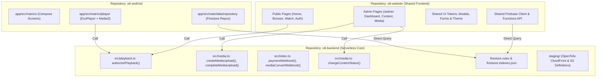
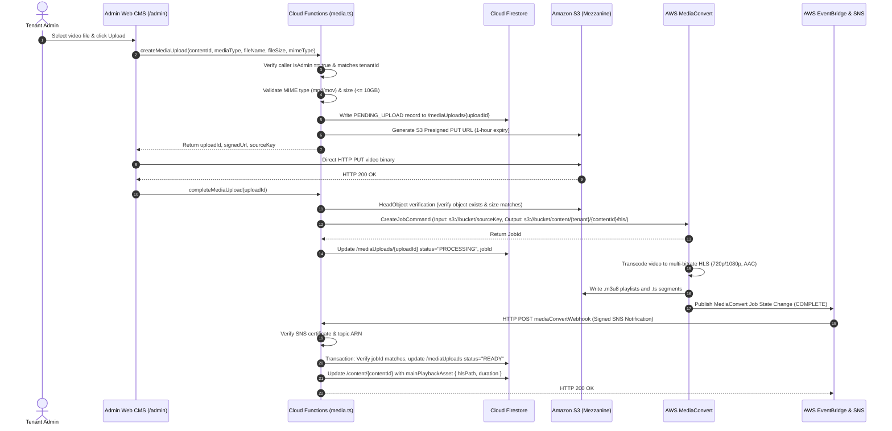
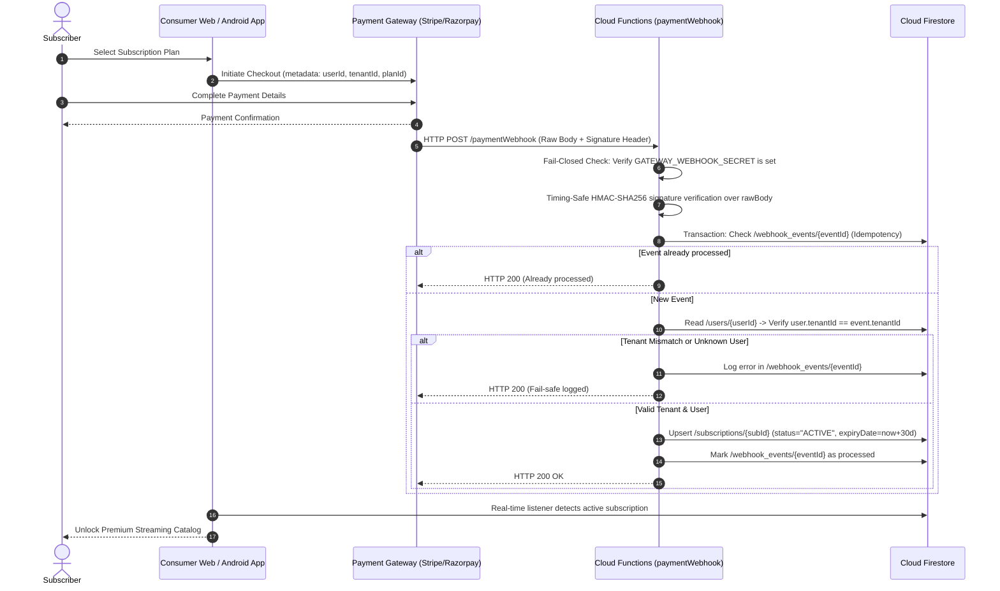
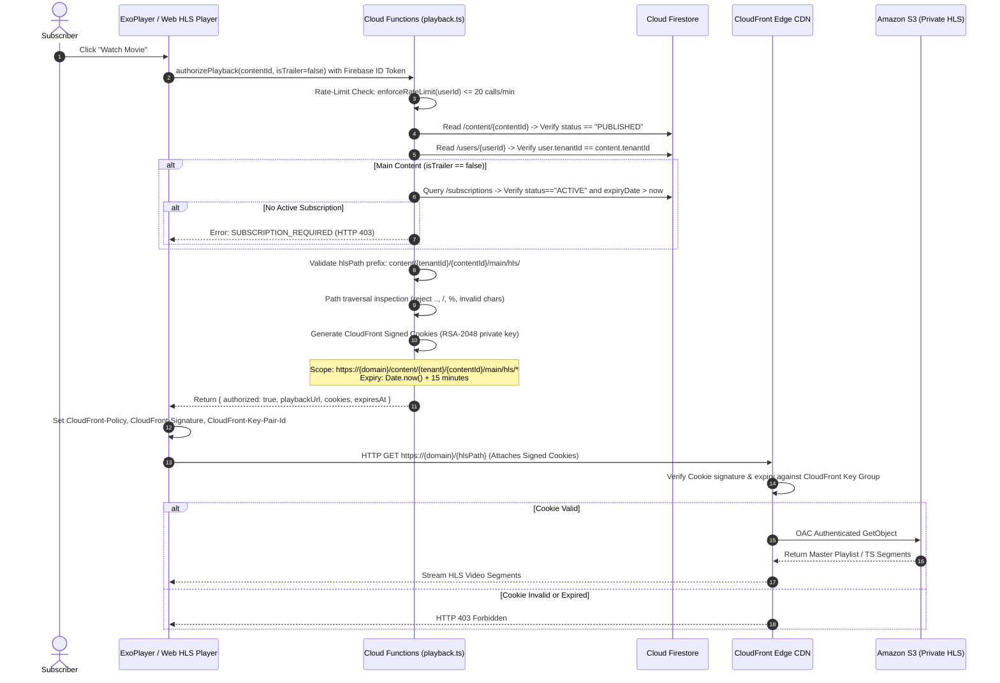

# Unified OTT Platform — System Architecture Specification

- **Document Version:** 1.0.0
- **Document Status:** PROPOSED ARCHITECTURE BASELINE (Phase 2 Deliverable)
- **Author:** Principal Software Architect, Cloud Infrastructure Architect, Application Security Architect
- **Target Platform:** Multi-Tenant Subscription OTT SaaS (Android Native, Consumer Web, Integrated Admin CMS, Serverless Backend, AWS Media Processing & Delivery)

---

## 1. Executive Overview

This document establishes the definitive, unified system architecture for the OTT streaming platform. The platform delivers premium, subscription-gated video streaming through a native Android application and a modern consumer website, supported by an integrated administrative Content Management System (CMS) under `/admin`, a serverless cloud backend, and a cloud-native AWS media transcoding and delivery pipeline.

The architecture strictly adheres to the core product philosophy established in `MASTER.md`:
1. **Simple, Serverless Infrastructure:** No VPS hosting, no monolithic web servers, no self-managed Docker/Kubernetes clusters, and no traditional database maintenance.
2. **Server-Authoritative Security & Entitlements:** Zero trust in client requests. Playback access, upload pre-signatures, subscription status, and administrative actions are strictly validated and cryptographically enforced by serverless backend logic.
3. **Multi-Tenant SaaS Foundation:** The data model, storage keys, and delivery tokens are logically partitioned by `tenantId`, enabling multi-brand OTT operations on a shared, highly cost-effective cloud infrastructure.
4. **Subscription-Only Model:** Public trailers are permitted without subscription where configured, but main premium content requires an active, verified subscription.
5. **Phase-Gated Engineering Discipline:** Local validation, contract establishment, and staging preparation occur in Phases 2–8. Live deployment and end-to-end cloud validation are strictly reserved for Phase 9.

---

## 2. Product Boundaries & System Context

The platform encompasses four primary boundaries:
- **Consumer Clients:** Native Android application (Jetpack Compose + Media3/ExoPlayer) and responsive consumer streaming website (Next.js / React SPA).
- **Administrative CMS:** Web-based operational console hosted under `/admin` within the website codebase, secured by role-based guards.
- **Application Backend:** Firebase Authentication for identity, Cloud Firestore for application state, and Firebase Cloud Functions (TypeScript/Node.js) for trusted backend operations and webhook ingestion.
- **Media Processing & Distribution:** Private Amazon S3 storage, AWS Elemental MediaConvert for adaptive HLS transcoding, and Amazon CloudFront with Origin Access Control (OAC) and Signed Cookies for secure streaming delivery.

### 2.1 System Context Diagram

```mermaid
flowchart TB
    subgraph Users ["External Users & Actors"]
        Sub["Subscriber / Consumer"]
        Anon["Anonymous Viewer"]
        AdminUser["Tenant Administrator"]
        Gateway["Payment Gateway (Stripe/Razorpay)"]
    end

    subgraph ClientLayer ["Client Layer"]
        AndroidApp["Native Android App\n(Kotlin, Compose, Media3)"]
        WebConsumer["Consumer Website\n(Next.js / React)"]
        WebAdmin["Admin CMS (/admin)\n(Shared Web Codebase)"]
    end

    subgraph BackendLayer ["Backend Layer (Firebase Platform)"]
        FirebaseAuth["Firebase Authentication\n(Identity & JWTs)"]
        Firestore["Cloud Firestore\n(Multi-Tenant Database)"]
        Functions["Firebase Cloud Functions\n(Serverless Business Logic)"]
    end

    subgraph MediaLayer ["Media Infrastructure (AWS Cloud)"]
        S3Source["Amazon S3\n(Private Mezzanine Storage)"]
        MediaConvert["AWS Elemental MediaConvert\n(HLS Transcoding)"]
        S3Dest["Amazon S3\n(Private HLS Output)"]
        CloudFront["Amazon CloudFront CDN\n(Signed Cookie Enforced)"]
        EventBridge["AWS EventBridge & SNS\n(State Change Notifications)"]
    end

    %% Client Interactions
    Sub -->|Browse & Stream| AndroidApp
    Sub -->|Browse & Stream| WebConsumer
    Anon -->|Browse & Watch Trailers| WebConsumer
    AdminUser -->|Manage Catalog & Ingest| WebAdmin

    %% Client to Backend
    AndroidApp -->|ID Tokens| FirebaseAuth
    AndroidApp -->|Direct Read (Rules Guarded)| Firestore
    AndroidApp -->|authorizePlayback()| Functions
    WebConsumer -->|ID Tokens| FirebaseAuth
    WebConsumer -->|Direct Read (Rules Guarded)| Firestore
    WebConsumer -->|authorizePlayback()| Functions
    WebAdmin -->|createMediaUpload()| Functions
    WebAdmin -->|changeContentStatus()| Functions
    WebAdmin -->|Admin Read/Write| Firestore

    %% Gateway to Backend
    Gateway -->|paymentWebhook (HMAC signed)| Functions
    Functions -->|Update Subscriptions| Firestore

    %% Media Workflow
    Functions -->|Pre-signed PUT URL| WebAdmin
    WebAdmin -->|Direct Upload| S3Source
    Functions -->|CreateJobCommand| MediaConvert
    S3Source -->|Input Video| MediaConvert
    MediaConvert -->|Output HLS (.m3u8, .ts)| S3Dest
    MediaConvert -->|Job Status Event| EventBridge
    EventBridge -->|mediaConvertWebhook| Functions
    Functions -->|Update Asset Status| Firestore

    %% Streaming Delivery
    Functions -->|Issue Signed Cookies| AndroidApp
    Functions -->|Issue Signed Cookies| WebConsumer
    AndroidApp -->|Play HLS with Cookies| CloudFront
    WebConsumer -->|Play HLS with Cookies| CloudFront
    CloudFront -->|OAC Authenticated Fetch| S3Dest
```

---

## 3. Component Architecture & Repository Ownership

### 3.1 Authoritative Component Matrix

| Component | Target Repository | Current Location | Runtime / Stack | Status | Primary Responsibility |
|---|---|---|---|---|---|
| **Android Application** | `ott-android` | `Android - OTT/app` | Kotlin, Jetpack Compose, Media3, Hilt | **IMPLEMENTED** (47 Unit tests pass) | Native mobile streaming client, ExoPlayer signed cookie playback, offline watchlist, profile management. |
| **Consumer Website** | `ott-website` | `Website/` (Empty) | Next.js / React, Vanilla CSS, Video.js / Hls.js | **PLANNED** (Phase 6) | Responsive web streaming client, public catalog browsing, trailer previews, subscriber checkout. |
| **Admin Web CMS** | `ott-website` | `Website/` (Empty) | Next.js / React (under `/admin`) | **PLANNED** (Phase 6) | Catalog management, S3 upload trigger, transcode monitoring, plan configuration, tenant oversight. |
| **Cloud Functions Backend** | `ott-backend` | `Android - OTT/functions` | TypeScript, Node.js 18, Firebase Admin SDK | **IMPLEMENTED** (35 Unit tests pass) | Playback authorization, upload pre-signing, MediaConvert job creation, webhook signature verification. |
| **Database & Rules** | `ott-backend` | `Android - OTT/firestore.rules` | Cloud Firestore, Firestore Rules v2 | **IMPLEMENTED** (Escaping defect fixed) | Real-time multi-tenant document store with field-level declarative security rules. |
| **Infrastructure as Code** | `ott-backend` / `infra` | `Android - OTT/staging` | OpenTofu v1.12, AWS Provider v5 | **IMPLEMENTED** (Validate passes, Plan blocked) | Provisions S3 bucket, CloudFront distribution, OAC, Key Groups, MediaConvert IAM, and SNS rules. |

### 3.2 Component Architecture Diagram



---

## 4. Key Architectural Sequences

### 4.1 Media Ingestion & Transcoding Sequence



### 4.2 Subscription Checkout & Webhook Reconciliation Sequence



### 4.3 Secure Playback Authorization Sequence



---

## 5. Technology Choices and Evaluation

| Subsystem | Technology | Rationale & Evidence | Trade-offs & Limitations |
|---|---|---|---|
| **Mobile Client** | Kotlin, Jetpack Compose, Media3/ExoPlayer | Industry standard for modern Android; 47 passing unit tests in `Android - OTT/app`. Native HLS cookie handling via `DefaultHttpDataSource`. | Android only; iOS requires future Swift implementation (deferred). |
| **Web Frontend** | Next.js App Router (or React SPA) + Vanilla CSS | Unified codebase for consumer and admin; eliminates dual deployments. Fast load times, SEO-ready for catalog pages. | Requires dynamic bundle splitting to prevent admin code leaking to consumers. |
| **Application Runtime** | Firebase Cloud Functions (Node.js 18) | Serverless, auto-scaling, zero idle cost; 35 passing unit tests; native Firebase Auth integration. | Cold starts (200–800ms); execution timeout limit of 9 minutes. |
| **Application Database** | Cloud Firestore | Managed serverless NoSQL; declarative security rules; real-time client listeners for subscription sync. | No SQL `JOIN`s; requires composite indexes and Algolia for full-text search. |
| **Identity & Access** | Firebase Authentication | Out-of-the-box secure token management, session handling, email/password & social login. | User document must mirror custom claims for complex RBAC. |
| **Media Storage** | Amazon S3 | High durability (99.999999999%), S3 lifecycle expiration of mezzanine files, bucket-owner enforced. | Cross-cloud networking from Firebase to AWS (mitigated by pre-signed URLs). |
| **Media Transcoding** | AWS Elemental MediaConvert | Fully managed broadcast-quality HLS transcoding; zero server maintenance; event-driven via EventBridge. | Account-specific regional endpoints required; costs scale per minute of encoded video. |
| **Media Distribution** | Amazon CloudFront (OAC) | Global edge caching; native support for RSA-2048 Signed Cookies; Origin Access Control isolates S3. | Key rotation requires updating both OpenTofu and Firebase Secrets. |

---

## 6. Architectural Assumptions & Boundaries

1. **Logical Multi-Tenancy:** Tenants share the same CloudFront distribution, S3 bucket, and Firestore database. Complete isolation is achieved cryptographically (signed cookie URL prefixes) and logically (`tenantId` field filters in Firestore rules and Cloud Functions).
2. **Third-Party Payment Gateway:** Payments are processed off-platform via the gateway's hosted checkout or client SDK. The backend does not store credit card numbers or handle raw PCI data.
3. **No Direct S3 Access:** Clients never communicate with Amazon S3 directly, except when uploading source mezzanine files via single-use, time-limited presigned PUT URLs.
4. **Client-Agnostic Backend:** Cloud Functions expose callable endpoints and HTTP webhooks that adhere to identical JSON schemas whether invoked by the Android app, the consumer website, or the admin CMS.
5. **Phase 9 Live-Deployment Reservation:** All architecture decisions are verified locally through compilers, linters, and unit tests in Phases 2–8. No live AWS resources or Firebase production instances will be deployed before Phase 9.

---

## 7. Major Architectural Trade-Offs

### 7.1 Serverless Cloud Functions vs. Dedicated Containerized API
- **Chosen:** Serverless Firebase Cloud Functions.
- **Why:** Keeps infrastructure simple and maintenance-free, adhering to Section 2.1 of `MASTER.md`. Baseline idle operating cost is $0.00/month.
- **Compromise:** Cold starts for infrequent requests (mitigated by CloudFront caching for assets and keep-alive pings if necessary).

### 7.2 Unified Web Codebase vs. Separate Consumer and Admin Repositories
- **Chosen:** Single frontend codebase in `Website/` with integrated `/admin` routes.
- **Why:** Avoids duplicating design systems, auth clients, and API types; halves hosting and CI/CD maintenance overhead.
- **Compromise:** Demands strict route middleware guarding and code splitting so administrative logic is never exposed to public viewers.

### 7.3 Logical Multi-Tenancy vs. Physical Project Isolation
- **Chosen:** Logical multi-tenancy partitioned by `tenantId`.
- **Why:** Drastically reduces cloud provisioning costs and avoids deploying hundreds of duplicate Firebase projects for small tenants.
- **Compromise:** Developers must rigorously enforce `tenantId` filtering in every Firestore query and Cloud Function transaction.
